# Olá, eu sou o Geraldo! 👋

## 👨‍💻 Sobre Mim
Sou um **Analista de Infraestrutura e Desenvolvedor** apaixonado por automação e desenvolvimento. Meu foco é criar soluções eficientes, desde bots para comunidades até pipelines de CI/CD complexos.

* 🔭 **Atualmente trabalhando em:** Automação de Infraestrutura, Desenvolvimento Mobile e Bots para Discord.
* 🌱 **Aprendendo:** Novas ferramentas de DevOps e orquestração.
* ☁️ **Interesses:** AWS, Automação (macOS/Linux), Jenkins e Desenvolvimento de Bots.

---

## 🛠️ Tech Stack

### ☁️ Cloud & DevOps

### 💻 Linguagens & Scripts

### 🎮 Outros

---

## 📊 Estatísticas do GitHub

<!-- Os cards abaixo são gerados pela GitHub Action em .github/workflows/update-stats.yml
     e salvos na pasta profile/ deste repositório, então não dependem de nenhum serviço externo. -->

  

  <picture>
    <source media="(prefers-color-scheme: dark)" srcset="./profile/snake-dark.svg"/>
    <source media="(prefers-color-scheme: light)" srcset="./profile/snake.svg"/>
    
  </picture>

---

  <i>"Code is like humor. When you have to explain it, it’s bad."</i>

